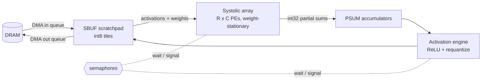

# Tessera

**A cycle-level simulator and tiling compiler for a systolic-array ML accelerator, in modern C++17.**

Tessera models a small ML accelerator core end to end: a register-level weight-stationary systolic
array, on-chip scratchpad (SBUF) and accumulator (PSUM) memories, DMA queues, and an activation engine,
all running concurrently and synchronizing through semaphores. A compiler lowers GEMMs and multi-layer
MLPs onto that hardware with tiling and double buffering. The simulator then runs the program, checks
the numbers against a golden model, reports per-engine utilization, and catches synchronization bugs
(deadlocks and data races) that a real hardware/software stack has to get right.

```text
$ ./build/tessera-run --m 256 --k 512 --n 256 --rows 32 --cols 32 --sbuf-kb 512 --psum-kb 256 --trace trace.json
{ "cycles": 55202, "pe_utilization": 0.594, "correct": true, ... }
```

Open `trace.json` in [Perfetto](https://ui.perfetto.dev) to see the DMA, tensor, and activation
engines overlap instruction by instruction.

## Why

Most of the performance of an ML accelerator is decided by software: how a layer is tiled to fit on-chip
memory, how data movement is overlapped with compute, and whether engines are synchronized correctly.
Tessera is a compact, testable model of that hardware-software boundary for experimenting with
those trade-offs.

## Architecture



| Component | File | What it does |
|---|---|---|
| Systolic array | `src/systolic.cpp` | Register-level model: activations shift right, partial sums shift down, skewed injection. Matches a closed-form timing model exactly (`k + m + n + R - 2` cycles). |
| Simulator | `src/simulator.cpp` | Discrete-event engine scheduler with semaphores, strided 2-D DMA, bounds checking, deadlock diagnostics, a dynamic race detector, and Chrome trace output. |
| Compiler | `src/compiler.cpp` | Tiles GEMM/MLP layers to on-chip capacity, assigns SBUF/PSUM buffer slots, emits per-engine instruction streams with the wait/signal edges for N-way buffering, and chains layers through DRAM. |
| Golden model | `src/reference.cpp` | Reference GEMM and int8 requantization (round half up, saturate). |
| CLI | `tools/tessera_cli.cpp` | Runs a workload, verifies it, prints JSON stats, and writes traces or dumps. |

### Synchronization model

Each engine executes its own instruction stream in order, and engines coordinate only through counting
semaphores. With `B` buffers, the compiler emits these edges for matmul `i` and output tile `j`:

| Instruction | Waits for | Signals |
|---|---|---|
| load A/W into slot `i % B` | `mm_done >= i - B + 1` (slot no longer being read) | `a_loaded`, `w_loaded` |
| matmul `i` | `a_loaded, w_loaded >= i + 1`; first K-tile also waits `act_done >= j - B + 1` | `mm_done` |
| epilogue `j` | `mm_done` covers all K-tiles of `j`; `store_done >= j - B + 1` | `act_done` |
| store `j` | `act_done >= j + 1` | `store_done` |

If any edge is missing, the race detector reports the two conflicting in-flight instructions.
`DroppingASynchronizationEdgeIsCaught` in the tests demonstrates this.

## Results

Generated with `python scripts/sweep.py` (int8 GEMM, 64-cycle DMA latency, 32 B/cycle per queue unless noted).

**Double buffering (GEMM 256x256x256)**

| array | cycles (1 buf) | cycles (2 buf) | speedup | PE util (1 buf) | PE util (2 buf) |
|---:|---:|---:|---:|---:|---:|
| 16x16 | 145732 | 78412 | 1.86x | 45.0% | 83.6% |
| 32x32 | 51328 | 28578 | 1.80x | 31.9% | 57.3% |
| 64x64 | 23344 | 15874 | 1.47x | 17.5% | 25.8% |

**DMA bandwidth sensitivity (32x32 array, GEMM 256x512x256, double buffered)**

| DMA B/cycle | cycles | PE util | DMA-in busy | PE busy | bound by |
|---:|---:|---:|---:|---:|---:|
| 8 | 168866 | 19.4% | 97.0% | 26.5% | DMA |
| 16 | 93090 | 35.2% | 96.8% | 48.1% | DMA |
| 32 | 55202 | 59.4% | 96.5% | 81.2% | DMA |
| 64 | 46164 | 71.0% | 75.4% | 97.0% | PE |
| 128 | 45836 | 71.5% | 55.9% | 97.7% | PE |
| 256 | 45672 | 71.7% | 46.0% | 98.1% | PE |

**Output tile height (32x32 array, GEMM 512x256x256, double buffered)**

| tile_m | matmuls | instructions | cycles | PE util |
|---:|---:|---:|---:|---:|
| 8 | 4096 | 13312 | 688346 | 4.8% |
| 16 | 2048 | 6656 | 360722 | 9.1% |
| 32 | 1024 | 3328 | 196994 | 16.6% |
| 64 | 512 | 1664 | 115298 | 28.4% |
| 128 | 256 | 832 | 74786 | 43.8% |
| 256 | 128 | 416 | 55202 | 59.4% |

What the numbers show:

- **Overlap matters most when DMA and compute are balanced.** Double buffering nearly doubles throughput
  on 16x16 and 32x32 arrays. On a 64x64 array the GEMM is too small to fill the pipeline, so per-tile
  fixed costs dominate.
- **There is a roofline crossover.** Below about 64 B/cycle the DMA-in queue is saturated and the array waits.
  Above it the kernel becomes compute-bound and more bandwidth stops helping.
- **"Busy" is not the same as "useful".** At 256 B/cycle the PE is busy 98% of the time but only 72% of
  peak MACs are useful. The rest is weight loading and systolic fill/drain (`k + R + n - 2` cycles per
  pass), which is why larger tiles and weight preloading pay off.

## Build and test

Requires CMake 3.16+ and a C++17 compiler. GoogleTest is used from the system if installed, otherwise
downloaded. Python end-to-end tests run if `pytest` is available.

```bash
cmake -S . -B build
cmake --build build -j
ctest --test-dir build --output-on-failure   # GoogleTest + PyTest

# Sanitizers
cmake -S . -B build-asan -DCMAKE_BUILD_TYPE=Debug -DTESSERA_SANITIZE=ON && cmake --build build-asan -j
ctest --test-dir build-asan
```

Testing strategy:

- **GoogleTest** (`tests/*.cpp`): systolic array against the golden GEMM across shapes including
  partial tiles; cycle-level timing against the analytical model; DMA strides and timing; semaphore
  ordering; deadlock and race detection; compiled GEMM/MLP correctness; capacity errors.
- **PyTest** (`tests/python`): drives the CLI and re-checks outputs with an independent pure-Python
  reference, validates the Chrome trace (no engine runs two instructions at once), and checks
  performance properties such as the double-buffering speedup and utilization bounds.
- **CI** (GitHub Actions): GCC and Clang with `-Werror`, plus an AddressSanitizer/UBSan job.

## CLI

```text
tessera-run [--m M --k K --n N | --m BATCH --mlp K0,K1,...,KL]
            [--relu] [--shift S] [--int8-out]
            [--buffers B] [--tile-m T]
            [--rows R] [--cols C] [--sbuf-kb KB] [--psum-kb KB]
            [--dma-bw BYTES] [--dma-latency CYCLES] [--act-lanes L]
            [--analytical] [--no-race-check] [--trace FILE] [--dump FILE] [--seed S]
```

`--analytical` swaps the register-level PE model for the closed-form one (identical cycle counts,
much faster) for large design-space sweeps.

## Modeling assumptions and roadmap

- Each matmul pass loads its weights (`k` cycles) and fills and drains the array. There is no
  cross-pass pipelining yet.
- Each DMA queue has independent bandwidth. A shared DRAM bandwidth model is not implemented.
- The race detector uses conservative bounding intervals for strided regions.
- Roadmap: shadow weight registers to hide weight loads, weight-reuse loop orders, a shared DRAM
  bandwidth model, and convolution lowering (im2col).

The SBUF/PSUM naming follows the convention in public ML-accelerator programming docs. Tessera is an
independent educational model and is not derived from any proprietary design.

## License

MIT
